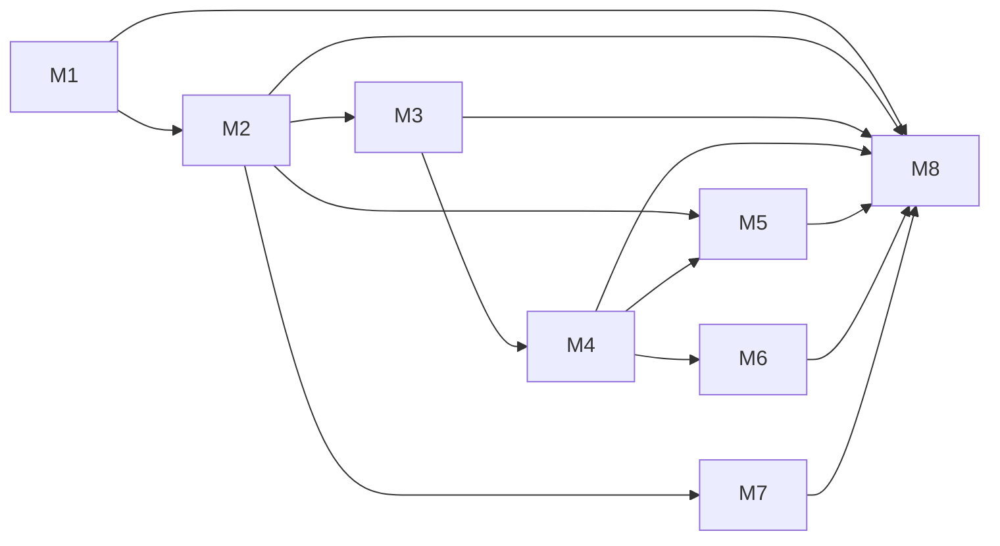

# 模块依赖与风险分析

> 第 8 周交付物 · 主笔：熊尚华
> 依据：`docs/architecture.md` 第 1 章《模块边界与职责》、第 2 章《架构全景（四层）》、`spec/mvp1-scope.md` 模块依赖列
> 版本：v0.2（D3 修订：风险表终稿、依赖出处与邻接表、示意改 Mermaid）
> 范围：只定模块间调用方向与分层约束，不定义内部函数、不写业务实现，不改动第 3 章核心数据实体

## 1. 分层依赖方向

四层严格单向，与 `architecture.md` 第 2 章一致：

```
展示层（Vue 3）  ──HTTP/JSON──▶  API 层（Controller）  ──调用──▶  服务层（Service）  ──调用 Mapper──▶  数据层（MySQL）
```

- 依赖方向只能从左到右，禁止反向与跨层循环。
- 展示层只消费 API 响应，禁止直连数据层（不直接连接 Mapper / 数据库）。
- 层间四条约束（展示层不判断业务规则、API 层不写业务规则、服务层不渲染页面、数据层不处理 UI）以 `architecture.md` 第 2 章为准，本文件不重复定义。

## 2. 模块依赖图

### 2.1 模块依赖关系

| 模块 | 直接依赖 | 调用性质 | 数据读写 |
|---|---|---|---|
| M1 简历上传与解析 | 无 | — | 写自有 `resume` |
| M2 霍兰德问卷与画像 | M1 | 读取已确认简历 | 写 `holland_profile` |
| M3 岗位推荐与外链 | M2 | 读取画像 | 写岗位外链元数据，不存岗位正文 |
| M4 投递状态登记 | M3 | 读取岗位信息 | 写 `application` |
| M5 文字模拟面试 | M2、M4 | 读画像、读投递记录 | 写模拟面试记录 |
| M6 面试登记与多级提醒 | M4 | 范围表依赖 M4；module-06 FR-1 仅录公司名/岗位文本，未关联投递（待 spec 补 FR） | 写 `interview`、`reminder` |
| M7 面经外链 | M2 | 基于 M2 画像方向优先排序（module-07 FR-4、AC-3） | 写 `interview_note` 外链，不存正文 |
| M8 求职档案看板 | M1、M2、M3、M4、M5、M6、M7 | 经只读视图 `v_dashboard` 间接聚合，不直接调用各模块服务 | 不写业务表，读取只读视图 `v_dashboard` |

**依赖出处与口径说明（D3 复核）**

- M6→M4：mvp1-scope 依赖列；module-06 FR-1 仅录公司名与岗位文本，未关联投递记录，登记理由取自范围表，待 M6 spec 补一条关联投递的 FR。
- M7→M2：module-07 FR-4 明确「基于 M2 画像的方向标签对相关面经做优先排序」，AC-3 规定画像方向缺失时不做个性化排序；第 1 章「不评分」指不做 M5 式打分，不否定 FR-4 的画像排序。故 M7 依赖 M2 成立，不改为「无」。
- M8→M1..M7：module-08 FR-1 与 5.8 明确聚合 M1–M7，方式为服务层并行读只读视图 v_dashboard，不直接调用各模块 Service，不产生反向调用。

### 2.2 依赖方向示意



> 箭头方向即「依赖 / 调用」方向，共 14 条边，与 2.3 邻接表完全一致；M8 经只读视图 v_dashboard 聚合，无反向边。

### 2.3 无环验证

对 2.1 的直接依赖做 DFS 环检测与 Kahn 拓扑排序，得到合法拓扑序列（依赖在前）：

**邻接表（key 为模块，value 为其直接依赖）**

```
M1: []
M2: [M1]
M3: [M2]
M4: [M3]
M5: [M2, M4]
M6: [M4]
M7: [M2]
M8: [M1, M2, M3, M4, M5, M6, M7]
```

共 14 条边。

**拓扑序（Kahn）**

```
M1 → M2 → M3 → M7 → M4 → M5 → M6 → M8
```

- 该序列覆盖全部 8 个模块；每个模块依赖的模块都排在它前面，因此依赖图**无环**。
- 环检测结果为 0 个环；拓扑序列长度 = 模块数 = 8。

## 3. 循环依赖与反向调用检查

### 3.1 检查方法

1. 按 `spec/mvp1-scope.md` 依赖列与 `architecture.md` 第 1 章边界表，建立 8 个模块的直接依赖邻接表。
2. 对邻接表执行 DFS 三色标记环检测，并用 Kahn 算法求拓扑序交叉验证。
3. 针对本项目三条必查项逐条核对调用方向与读写语义。

### 3.2 三条必查结论

| 检查项 | 结论 | 依据 |
|---|---|---|
| M3 不得反向依赖 M4 | 通过：M3 仅依赖 M2，不存在 M3→M4 边；M4→M3 为正向（投递登记读取岗位） | 2.1；M3 边界「不登记投递」 |
| M8 只读、不反写业务表 | 通过：M8 仅经只读接口 / 只读视图 `v_dashboard` 聚合，无任何写操作，不反写 M4 投递表 | 2.1；M8 边界「不写业务表」；NFR-3 |
| 展示层不得直连数据层 | 通过：展示层只向 API 层发起 HTTP 请求，无到 Mapper / 数据库的连接 | 第 1 章；第 2 章层间约束 |

### 3.3 反向调用全量核对

- 除 M8 外，每个模块只依赖拓扑序列中排在自己前面的模块，不存在指回后续模块的边。
- M8 位于拓扑序列末端，只被「输出」需要，M1–M7 均不依赖 M8，故 M8 不会成为环的一部分。
- 结论：**依赖图无循环、无反向调用、无展示层直连数据层**。

## 4. 风险表（D3 终稿）

> D1 先确定风险主题；D3 按模板补 ID、概率 两列，并逐条补齐「影响 / 应对 / 负责人 / 验证方式」，不留空格。

D3 须覆盖的 8 个风险主题（对应任务分配表）：并发、幂等、大模型超时、外链失效、空数据、越权、AI 风格割裂、实例与库限制。

| ID | 风险主题 | 概率 | 影响 | 应对 | 负责人 | 验证方式 |
|---|---|---|---|---|---|---|
| R1 | 并发 | 中 | M4 同一学生同一岗位并发登记，可能产生重复投递记录、状态流转竞争 | 乐观锁 version 控制并发状态流转，冲突返回 409 INVALID_STATUS_TRANSITION；唯一约束 (student_id, job_id) 兜底（ADR-001） | 赵蔚 | S1 探针 10 线程×100 轮：写入恒为 1、500 为 0；版本号冲突返回 409 且字段不变 |
| R2 | 幂等 | 高 | 连点或重复提交导致重复记录 | 数据库唯一约束 (student_id, job_id) 硬拦截，捕获 DuplicateKeyException 返回 409 ALREADY_APPLIED，不产生新记录（ADR-001） | 赵蔚 | S1 实测 100 轮：2xx=100、409 ALREADY_APPLIED=900、写入恒为 1、500=0 |
| R3 | 大模型超时 | 中 | M1 等调用大模型延迟或超时，系统卡死、白屏占线程 | 30 秒超时、最多重试 2 次、间隔 1 秒，耗尽返回 504 PARSE_TIMEOUT；前端 Loading、按钮置灰、超时提示（ADR-002） | 卢果、贾小舒 | S4 实测：单次 30s 触发超时、三次 92s 返回 504，均有 Loading 且按钮置灰 |
| R4 | 外链失效 | 中 | M7 面经外链打不开或失效，点击无响应 | 24 小时探测、点击 3 秒判失效，200 内返回 linkStatus=INVALID 置灰标记，不整页报错；SSRF 统一校验 | 熊尚华 | D4 用例：置一条失效外链，点开断言 200 + linkStatus=INVALID、不整页报错（S2 探针兜底） |
| R5 | 空数据 | 高 | 画像算不出专业/技能标签时按错误处理会 500 中断、学生卡画像页；直接返空数组则 M3 排不出岗位、M8 整屏空白 | M2 合成后仍返 200、body 带降级标记 PROFILE_SKILL_MISSING（AC-5，标记非错误码），前端显示「技能标签待补充」；M3 拿不到画像按霍兰德类型单维召回并提示降级；M8 无数据返空数组+空态文案，不返 500 | 贾小舒、熊尚华 | D4 用例：不含技能关键词简历跑 M1→M2 断言 200 且含 PROFILE_SKILL_MISSING、页面无报错；新学生无投递 GET /api/v1/dashboard 断言 200+各分区空数组 |
| R6 | 越权 | 低 | 学生改请求体 resumeId 或换身份即可读写他人数据，简历含手机号/邮箱/教育经历，越权即隐私事故 | 所有学生数据端点从 JWT 取 studentId、不接受请求体传入；M1 POST /resumes/confirm 带 resumeId 校验归属当前学生、不属返 404、写库以 student_id 为准 upsert；M1 读接口无记录返 data:null；M8 越权返 403 DASHBOARD_FORBIDDEN（AC-6、NFR-4、边界行 5） | 贾小舒、熊尚华 | D4 用例：学生 B token 提交学生 A resumeId 调 confirm 断言 404 且 A 档案时间戳未变；他人身份请求 M8 断言 403 DASHBOARD_FORBIDDEN 且响应体不含业务字段 |
| R7 | AI 风格割裂 | 中 | 大模型返回自然语言、格式漂移或幻觉，JSON 解析报 500、多模块风格不一致 | 强制结构化 JSON，过 JSON Schema 校验才返回或入库，失败返回 502 MODEL_OUTPUT_INVALID，原档案不变（ADR-002） | 卢果、贾小舒 | S4 实测非法 JSON 1.2s 返回 502，有格式异常提示与重试入口 |
| R8 | 实例与库限制 | 中 | 单实例部署、文件与库容量约束，超量或非法文件、并发上限 | M1 单份 >10MB 返回 413 RESUME_TOO_LARGE、非 PDF/Word 返回 415 RESUME_FORMAT_UNSUPPORTED；单模块可独立部署，不引入 Redis/MQ，RDS 独立隔离 | 贾小舒、赵蔚 | D4 用例：上传 10MB+1KB 断言 413、非 PDF/Word 断言 415（S1 单实例实测数据兜底） |

## 5. 验证方式

- 依赖关系与 `architecture.md` 第 1 章边界表、`spec/mvp1-scope.md` 依赖列逐项核对一致。
- 环检测与拓扑排序结论：0 个环，拓扑序 `M1 → M2 → M3 → M7 → M4 → M5 → M6 → M8` 覆盖全部模块。
- 三条必查项（3.2）全部通过。
- D3 由 A 组裁判按 G10 口径复核依赖图与风险表；依赖方向若需变更，按第 6 章冻结规则登记，不接受例外。
