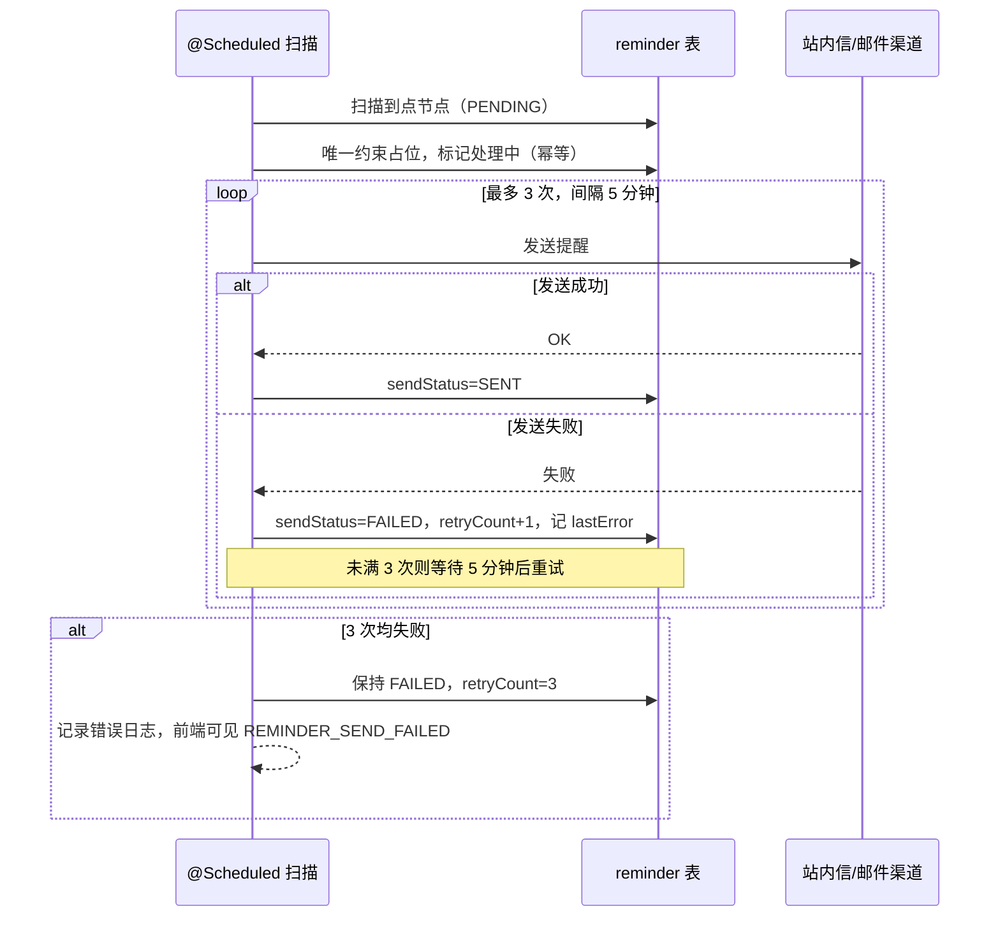

# T10：M6 面试登记与多级提醒（Mock 骨架）

> 对应 Issue：#（待填）｜分支：`feature/issue-XXX-m6-mock-reminder`（从 `main` 切出，一任务一分支）
> 对应 spec/AC：`spec/module-06-interview-reminder.md` AC-1、AC-2、AC-3、AC-4、AC-5、AC-6、AC-7、AC-8、AC-9
> 契约来源：`docs/architecture.md` §4.6（冻结契约，本文件只做 Mock 落地，不改契约、不新增 spec 之外的业务错误码）
> 形态说明：本 PR 为 **docs-only 契约骨架 + 写死 Mock**（代码块仅作示意，不进入构建），不连库、不写业务规则，不接真实推送 / 短信渠道（站内信 + 邮件仅固化口径）。按 2026-11-24 团队口径，骨架 PR 统一走「评审 → 返修 → APPROVE → 合并」：本骨架经评审 APPROVE 后合入 `main` 并删除分支；第 10 周实现从最新 `main` 新开 `feature/issue-XXX-m6-mock-reminder-impl` 分支（Issue 编号保持不变），在实现分支把示意代码替换为可编译的 Controller / Service / Mapper 与前端页面并补自动化测试。统一响应壳 `com.campus.career.common.ApiResponse`、`RequestIdFilter`、`GlobalExceptionHandler` 已在 `main`（M1 上传链路），其余 Service / Mapper、MapStruct、`@Scheduled` 扫描与真实渠道调用在实现分支接入。

## 1. 端点总览（architecture §4.6）

| # | 方法 | URL | 用途 | 对应 spec |
|---|---|---|---|---|
| 1 | POST | `/api/v1/interviews` | 登记面试，生成 5 次提醒 | AC-1、AC-2、AC-8 |
| 2 | PATCH | `/api/v1/interviews/{interviewId}` | 改期或取消，旧提醒失效并重算 | AC-5、AC-9 |
| 3 | GET | `/api/v1/interviews/{interviewId}/reminders` | 查询该面试的提醒任务状态 | AC-2、AC-6、AC-7 |
| 4 | GET | `/api/v1/interviews/{interviewId}/calendar` | 导出 `.ics` 日历文件 | AC-4 |

M6 不记录面试结果、不算匹配度；5 次触发 = 4 个前置节点（前 3 天 / 前 1 天 / 前 2 小时 / 前 30 分钟）+ 1 个结束后复盘节点，节点枚举严格取 `D3 / D1 / H2_DEPARTURE / M30 / POST_REVIEW`。

## 2. POST `/api/v1/interviews` 登记面试

**请求**

- Header：`Authorization: Bearer <JWT>`
- Body：

```json
{
  "company": "某科技有限公司",
  "position": "后端开发实习生",
  "startTime": "2026-11-21T14:00:00+08:00",
  "departureTime": "2026-11-21T12:30:00+08:00",
  "location": "杭州市余杭区某大厦",
  "format": "OFFLINE"
}
```

- `startTime` 为 ISO 8601 带时区；`departureTime` 可为空，为空时前 2 小时节点按 `startTime` 倒推并置 `baselineFallback = true`（AC-8）。
- `format` 取 `ONLINE / OFFLINE`；`ONLINE` 时 `location` 填会议链接，`OFFLINE` 时填详细地址（边界表「未填面试地点」）。

### 2.1 `201 Created` 成功 Mock（AC-1，5 节点）

```json
{
  "code": "OK",
  "requestId": "mock_d7e5f4a3",
  "data": {
    "interviewId": "itv_20261121_001",
    "status": "SCHEDULED",
    "reminders": [
      {
        "nodeType": "D3",
        "triggerAt": "2026-11-18T14:00:00+08:00"
      },
      {
        "nodeType": "D1",
        "triggerAt": "2026-11-20T14:00:00+08:00"
      },
      {
        "nodeType": "H2_DEPARTURE",
        "triggerAt": "2026-11-21T10:30:00+08:00"
      },
      {
        "nodeType": "M30",
        "triggerAt": "2026-11-21T13:30:00+08:00"
      },
      {
        "nodeType": "POST_REVIEW",
        "triggerAt": "2026-11-21T16:00:00+08:00"
      }
    ],
    "baselineFallback": false
  }
}
```

**节点计算基准（评审意见 1：体现 departureTime 联动）**

| nodeType | 含义 | 计算规则 | 本例推导 | 结果 |
|---|---|---|---|---|
| `D3` | 前 3 天 | `startTime - 3d` | `11-21 14:00 - 3d` | `11-18 14:00` |
| `D1` | 前 1 天 | `startTime - 1d` | `11-21 14:00 - 1d` | `11-20 14:00` |
| `H2_DEPARTURE` | 前 2 小时 | `departureTime - 2h`（缺失则 `startTime - 2h`） | `11-21 12:30 - 2h` | `11-21 10:30` |
| `M30` | 前 30 分钟 | `startTime - 30min` | `11-21 14:00 - 30min` | `11-21 13:30` |
| `POST_REVIEW` | 结束后复盘 | `startTime + 2h`（见 §8 待裁定项 R-1） | `11-21 14:00 + 2h` | `11-21 16:00` |

> `H2_DEPARTURE` 的 `10:30` **由请求体 `departureTime = 12:30` 减 2 小时得到**，不是由 `startTime` 倒推；真实实现必须先判空 `departureTime` 再选基线（§6 Service 骨架注释、§8 评审对照表）。

### 2.2 `201 Created` 出发时间缺失降级 Mock（AC-8，`baselineFallback = true`）

请求体去掉 `departureTime`：`H2_DEPARTURE` 改为 `startTime - 2h = 12:00`，其余节点不变，并回传标记供前端提示「按开始时间估算出发提醒」。

```json
{
  "code": "OK",
  "requestId": "mock_d7e5f4a4",
  "data": {
    "interviewId": "itv_20261121_002",
    "status": "SCHEDULED",
    "reminders": [
      {
        "nodeType": "D3",
        "triggerAt": "2026-11-18T14:00:00+08:00"
      },
      {
        "nodeType": "D1",
        "triggerAt": "2026-11-20T14:00:00+08:00"
      },
      {
        "nodeType": "H2_DEPARTURE",
        "triggerAt": "2026-11-21T12:00:00+08:00"
      },
      {
        "nodeType": "M30",
        "triggerAt": "2026-11-21T13:30:00+08:00"
      },
      {
        "nodeType": "POST_REVIEW",
        "triggerAt": "2026-11-21T16:00:00+08:00"
      }
    ],
    "baselineFallback": true
  }
}
```

### 2.3 失败响应

| 状态码 | 错误码 | 触发条件 | 数据影响 | 出处 |
|---|---|---|---|---|
| 400 | —（无业务码） | `startTime` 早于当前时间（提醒时间已过） | 不写库、不生成提醒 | 边界表「时间冲突」 |
| 400 | —（无业务码） | `ONLINE` 未填会议链接，或 `OFFLINE` 未填详细地址 | 不写库 | 边界表「未填面试地点」 |
| 500 | `REMINDER_SEND_FAILED` | 5 个节点中任一提醒发送失败，重试 3 次（间隔 5 分钟）仍失败 | 面试登记不落库；前端保留表单草稿 | AC-2、AC-6、AC-8 |

统一失败响应体（以 `REMINDER_SEND_FAILED` 为例；该码在 §4 提醒状态中亦作为 `lastError` 字段值出现，见 §8 待裁定项 R-2）：

```json
{
  "code": "REMINDER_SEND_FAILED",
  "message": "提醒发送失败，已重试3次",
  "requestId": "mock_err_002"
}
```

## 3. PATCH `/api/v1/interviews/{interviewId}` 改期或取消

**请求（改期）**

```json
{
  "startTime": "2026-11-22T10:00:00+08:00",
  "departureTime": "2026-11-22T08:30:00+08:00"
}
```

**请求（取消）**

```json
{
  "status": "CANCELLED"
}
```

### 3.1 `200 OK` 改期成功 Mock（AC-9，旧提醒失效 + 重算）

改期后旧 5 条提醒全部置失效（`oldRemindersInvalidated = true`），按新时间重算未过期节点；已过期的 `D3` / `D1` 列入 `skippedExpiredNodes`，不触发。

```json
{
  "code": "OK",
  "requestId": "mock_e8f6a5b4",
  "data": {
    "interviewId": "itv_20261121_001",
    "status": "RESCHEDULED",
    "oldRemindersInvalidated": true,
    "newReminders": [
      {
        "nodeType": "H2_DEPARTURE",
        "triggerAt": "2026-11-22T06:30:00+08:00"
      },
      {
        "nodeType": "M30",
        "triggerAt": "2026-11-22T09:30:00+08:00"
      },
      {
        "nodeType": "POST_REVIEW",
        "triggerAt": "2026-11-22T12:00:00+08:00"
      }
    ],
    "skippedExpiredNodes": ["D3", "D1"]
  }
}
```

### 3.2 `200 OK` 取消成功 Mock（AC-5）

```json
{
  "code": "OK",
  "requestId": "mock_e8f6a5b5",
  "data": {
    "interviewId": "itv_20261121_001",
    "status": "CANCELLED",
    "oldRemindersInvalidated": true,
    "cancelledAt": "2026-11-21T09:00:00+08:00"
  }
}
```

- 取消时旧提醒全部失效，后续 `@Scheduled` 扫描直接跳过，阻断全部未触发推送（AC-5）。

### 3.3 失败响应（评审意见 3：覆盖 409 冲突）

| 状态码 | 错误码 | 触发条件 | 数据影响 | 出处 |
|---|---|---|---|---|
| 404 | —（无业务码） | `interviewId` 不存在或不属于当前学生 | 不修改任何数据 | 通用鉴权约束（不暴露存在性） |
| 400 | —（无业务码） | 改期后的 `startTime` 早于当前时间 | 旧提醒保持不变，不重算 | 边界表「时间冲突」 |
| 409 | —（无业务码） | 对已取消的面试再次执行 PATCH | 不修改状态 | 通用鉴权约束（不暴露存在性） |
| 409 | —（无业务码） | 改期成功后调度器仍尝试触发旧时间的任务 | 强制拦截丢弃推送，确保「改期后旧提醒失效」 | 边界表「改期或取消后旧提醒失效与重建」；AC-9 |

409（`改期后旧节点仍被触发`）的失败响应体示意：

```json
{
  "code": "-",
  "message": "该提醒节点已因改期失效，已丢弃本次推送",
  "requestId": "mock_err_003"
}
```

## 4. GET `/api/v1/interviews/{interviewId}/reminders` 查询提醒任务状态

Header 带 JWT，无 Body。`sendStatus` 取 `PENDING / SENT / FAILED`；`FAILED` 时带 `retryCount` 与 `lastError`（AC-6）。

### 4.1 `200 OK` 成功 Mock（含 SENT / FAILED，评审意见 2：FAILED 中间态）

```json
{
  "code": "OK",
  "requestId": "mock_f9a7b6c5",
  "data": {
    "interviewId": "itv_20261121_001",
    "reminders": [
      {
        "reminderId": "rmd_20261121_001",
        "nodeType": "D3",
        "triggerAt": "2026-11-18T14:00:00+08:00",
        "sendStatus": "SENT",
        "channel": ["IN_APP", "EMAIL"]
      },
      {
        "reminderId": "rmd_20261121_003",
        "nodeType": "H2_DEPARTURE",
        "triggerAt": "2026-11-21T10:30:00+08:00",
        "sendStatus": "FAILED",
        "retryCount": 3,
        "lastError": "REMINDER_SEND_FAILED",
        "channel": ["IN_APP", "EMAIL"]
      }
    ]
  }
}
```

- `reminderId` 为提醒任务唯一标识；后续手动忽略 / 单独重试须依赖此主键。
- 同一 `(interview_id, node_type)` 只存在一条记录，`@Scheduled` 通过唯一约束拦截重复触发（AC-7）。

**发送失败重试机制（评审意见 2：序列口径）**



### 4.2 失败响应

| 状态码 | 错误码 | 触发条件 | 数据影响 | 出处 |
|---|---|---|---|---|
| 404 | —（无业务码） | `interviewId` 不存在或不属于当前学生 | 不返回任何提醒数据 | 通用鉴权约束（不暴露存在性） |
| 409 | —（无业务码） | 调度器扫描周期重叠，尝试对已发送节点发起重复推送 | 执行幂等拦截，不产生重复推送 | AC-7 |

## 5. GET `/api/v1/interviews/{interviewId}/calendar` 导出 `.ics`

Header 带 JWT，无 Body。`Content-Type: text/calendar; charset=utf-8`，Body 为 `.ics` 文件流；仅做导出，不参与站内提醒（FR-4 / Non-Goals）。

### 5.1 `200 OK` 成功 Mock（`.ics` 文件流）

```text
BEGIN:VCALENDAR
VERSION:2.0
PRODID:-//Campus Career//Interview Calendar//CN
BEGIN:VEVENT
UID:itv_20261121_001@campus-career
DTSTART:20261121T060000Z
DTEND:20261121T070000Z
SUMMARY:面试 - 某科技有限公司 后端开发实习生
LOCATION:杭州市余杭区某大厦
END:VEVENT
END:VCALENDAR
```

### 5.2 失败响应

| 状态码 | 错误码 | 触发条件 | 数据影响 | 出处 |
|---|---|---|---|---|
| 404 | —（无业务码） | `interviewId` 不存在或不属于当前学生 | 不生成文件 | 通用鉴权约束（不暴露存在性） |
| 409 | —（无业务码） | 面试已取消 | 不生成文件 | AC-5 |

## 6. Java 骨架（契约示意代码块，暂不进入构建）

> 仅固化路由与字段：方法体返回写死 Mock（自包含 `Map`，与 T6 Mock 骨架一致），不注入 Mapper、不写业务规则、不接真实推送渠道。
> **`requestId` 口径（评审阻塞 1）**：下方 Mock 方法显式 `put("requestId", …)` 仅为冻结完整响应结构、避免照抄时漏字段；正式实现中 `requestId` 由 `RequestIdFilter` 每请求生成（8 位十六进制，同值写入请求属性、`X-Request-Id` 响应头与 MDC），Controller 经 `ApiResponse.ok(requestId, data)` / `ApiResponse.error(...)` 由统一返回壳序列化，业务代码不手写固定值。
> **时间基线口径（评审意见 1）**：Service 层计算 5 节点时须先判空 `departureTime`——非空取 `departureTime - 2h`，为空取 `startTime - 2h` 并置 `baselineFallback = true`；`POST_REVIEW` 按 `startTime + 2h`（待裁定项 R-1）。
> 实现分支（骨架 PR 合并后从最新 `main` 新开的 `-impl` 分支）在现有工程上替换为 `Controller → Service → Mapper → Entity` 分层实现并补测试；统一响应壳、全局异常处理已在 `main`，Bean Validation、MapStruct、`@Scheduled` 扫描、持久化与构造器注入规范在实现分支接入。

目标落地路径：`src/main/java/com/campus/career/controller/M6InterviewReminderController.java`

```java
package com.campus.career.controller;

import org.springframework.http.HttpStatus;
import org.springframework.web.bind.annotation.*;

import java.util.LinkedHashMap;
import java.util.List;
import java.util.Map;

/**
 * T10 / M6 面试登记与多级提醒契约骨架（Mock）。
 * 仅冻结路由与响应字段：方法体写死返回，不连库、不写业务规则、不接真实推送渠道。
 * 5 节点计算、改期重算、发送失败重试（3 次 / 间隔 5 分钟）与幂等归属 Service 层，本类不实现。
 */
@RestController
@RequestMapping("/api/v1/interviews")
public class M6InterviewReminderController {

    /** POST /api/v1/interviews：登记面试并生成 5 节点；Mock 返回固定节点集。 */
    @PostMapping
    @ResponseStatus(HttpStatus.CREATED)
    public Map<String, Object> createInterview(@RequestBody Map<String, Object> request) {
        // MOCK：正式实现改为 @Valid @RequestBody CreateInterviewRequest。
        // 时间基线：departureTime 非空 -> -2h；为空 -> startTime -2h 且 baselineFallback=true。
        Map<String, Object> r1 = new LinkedHashMap<>();
        r1.put("nodeType", "D3");
        r1.put("triggerAt", "2026-11-18T14:00:00+08:00");
        Map<String, Object> r2 = new LinkedHashMap<>();
        r2.put("nodeType", "D1");
        r2.put("triggerAt", "2026-11-20T14:00:00+08:00");
        Map<String, Object> r3 = new LinkedHashMap<>();
        r3.put("nodeType", "H2_DEPARTURE");
        r3.put("triggerAt", "2026-11-21T10:30:00+08:00"); // departureTime(12:30) - 2h
        Map<String, Object> r4 = new LinkedHashMap<>();
        r4.put("nodeType", "M30");
        r4.put("triggerAt", "2026-11-21T13:30:00+08:00");
        Map<String, Object> r5 = new LinkedHashMap<>();
        r5.put("nodeType", "POST_REVIEW");
        r5.put("triggerAt", "2026-11-21T16:00:00+08:00"); // startTime + 2h（待裁定项 R-1）

        Map<String, Object> data = new LinkedHashMap<>();
        data.put("interviewId", "itv_20261121_001");
        data.put("status", "SCHEDULED");
        data.put("reminders", List.of(r1, r2, r3, r4, r5));
        data.put("baselineFallback", false);

        Map<String, Object> resp = new LinkedHashMap<>();
        resp.put("code", "OK");
        resp.put("requestId", "mock_d7e5f4a3"); // MOCK 固定值仅冻结结构；正式由 ApiResponse.ok 注入
        resp.put("data", data);
        return resp;
    }

    /** PATCH /api/v1/interviews/{interviewId}：改期或取消；Mock 返回旧提醒失效 + 重算结果。 */
    @PatchMapping("/{interviewId}")
    public Map<String, Object> reschedule(
            @PathVariable String interviewId,
            @RequestBody Map<String, Object> body) {
        // MOCK：改期 -> status=RESCHEDULED + newReminders + skippedExpiredNodes；
        // 取消 -> status=CANCELLED；已取消后再 PATCH -> 409；旧节点仍被触发 -> 409 拦截丢弃。
        Map<String, Object> n1 = new LinkedHashMap<>();
        n1.put("nodeType", "H2_DEPARTURE");
        n1.put("triggerAt", "2026-11-22T06:30:00+08:00");
        Map<String, Object> n2 = new LinkedHashMap<>();
        n2.put("nodeType", "M30");
        n2.put("triggerAt", "2026-11-22T09:30:00+08:00");
        Map<String, Object> n3 = new LinkedHashMap<>();
        n3.put("nodeType", "POST_REVIEW");
        n3.put("triggerAt", "2026-11-22T12:00:00+08:00");

        Map<String, Object> data = new LinkedHashMap<>();
        data.put("interviewId", interviewId);
        data.put("status", "RESCHEDULED");
        data.put("oldRemindersInvalidated", true);
        data.put("newReminders", List.of(n1, n2, n3));
        data.put("skippedExpiredNodes", List.of("D3", "D1"));

        Map<String, Object> resp = new LinkedHashMap<>();
        resp.put("code", "OK");
        resp.put("requestId", "mock_e8f6a5b4");
        resp.put("data", data);
        return resp;
    }

    /** GET /api/v1/interviews/{interviewId}/reminders：查询提醒状态；Mock 含 SENT/FAILED 两条。 */
    @GetMapping("/{interviewId}/reminders")
    public Map<String, Object> listReminders(@PathVariable String interviewId) {
        // MOCK：FAILED 时带 retryCount=3 与 lastError=REMINDER_SEND_FAILED（重试 3 次 / 间隔 5 分钟）。
        Map<String, Object> sent = new LinkedHashMap<>();
        sent.put("reminderId", "rmd_20261121_001");
        sent.put("nodeType", "D3");
        sent.put("triggerAt", "2026-11-18T14:00:00+08:00");
        sent.put("sendStatus", "SENT");
        sent.put("channel", List.of("IN_APP", "EMAIL"));
        Map<String, Object> failed = new LinkedHashMap<>();
        failed.put("reminderId", "rmd_20261121_003");
        failed.put("nodeType", "H2_DEPARTURE");
        failed.put("triggerAt", "2026-11-21T10:30:00+08:00");
        failed.put("sendStatus", "FAILED");
        failed.put("retryCount", 3);
        failed.put("lastError", "REMINDER_SEND_FAILED");
        failed.put("channel", List.of("IN_APP", "EMAIL"));

        Map<String, Object> data = new LinkedHashMap<>();
        data.put("interviewId", interviewId);
        data.put("reminders", List.of(sent, failed));

        Map<String, Object> resp = new LinkedHashMap<>();
        resp.put("code", "OK");
        resp.put("requestId", "mock_f9a7b6c5");
        resp.put("data", data);
        return resp;
    }

    /** GET /api/v1/interviews/{interviewId}/calendar：导出 .ics；正式实现返回 text/calendar 文件流。 */
    @GetMapping("/{interviewId}/calendar")
    public String exportCalendar(@PathVariable String interviewId) {
        // MOCK：正式实现按 reminder 视图拼装 VEVENT 并设置 Content-Type: text/calendar。
        return "BEGIN:VCALENDAR\nVERSION:2.0\nPRODID:-//Campus Career//Interview Calendar//CN\nEND:VCALENDAR\n";
    }
}
```

DTO / VO 字段契约（md 示意代码块，落地时按类拆到 `dto/interview`、`vo/interview` 包）：

```java
package com.campus.career.dto.interview;

/** 登记请求：departureTime 可为空，为空时 H2 基线回退 startTime。 */
public record CreateInterviewRequest(
        String company,
        String position,
        String startTime,
        String departureTime,
        String location,
        String format) {
}

/** 改期请求：status=CANCELLED 表示取消，否则按新时间重算。 */
public record UpdateInterviewRequest(String startTime, String departureTime, String status) {
}
```

```java
package com.campus.career.vo.interview;

import java.util.List;

/** 提醒节点：nodeType 严格取五枚举。 */
public record ReminderNodeVO(String nodeType, String triggerAt) {
}

/** 登记 VO。baselineFallback 标识出发时间缺失的兜底基线。 */
public record InterviewVO(
        String interviewId,
        String status,
        List<ReminderNodeVO> reminders,
        Boolean baselineFallback) {
}

/** 改期 VO：旧提醒失效标记 + 新节点 + 已过期跳过的节点枚举。 */
public record RescheduleVO(
        String interviewId,
        String status,
        Boolean oldRemindersInvalidated,
        List<ReminderNodeVO> newReminders,
        List<String> skippedExpiredNodes) {
}

/** 提醒任务 VO：sendStatus 取 PENDING / SENT / FAILED；FAILED 时填 retryCount / lastError。 */
public record ReminderTaskVO(
        String reminderId,
        String nodeType,
        String triggerAt,
        String sendStatus,
        Integer retryCount,
        String lastError,
        List<String> channel) {
}
```

## 7. 前端页面骨架（Vue 3 + TS + Element Plus，示意代码块，暂不进入构建）

> 红线：`<script setup lang="ts">`、禁用 `any`；正式实现的 HTTP 调用必须经 composable / store，组件不直接 `fetch`/`axios`。当前仅用组件内写死数据做展示骨架，不发真实请求。状态机按 `REGISTER → SCHEDULED` 固化；`baselineFallback = true` 时在出发提醒节点标注「按开始时间估算」；取消面试须二次确认后阻断未触发提醒。

**组件树**

- `InterviewReminderView.vue`（主页面，承载状态机）
  - `InterviewRegisterView.vue`（**登记页**）→ `InterviewForm.vue`（公司、岗位、开始时间选择器、出发时间选择器、地点 / 链接输入框、[保存] 按钮）— `REGISTER`
  - `InterviewDetailView.vue`（**详情页**）
    - `ReminderTimeline.vue`（垂直时间轴，升序展示 5 个 `nodeType` + `triggerAt`）
    - `CalendarExportButton.vue`（[导出到日历(.ics)]）
    - `TimeEditDialog.vue`（[修改时间]，改后重算 5 节点）
    - `CancelInterviewButton.vue`（[取消面试]，二次确认）— `SCHEDULED`

**状态机与交互逻辑**

1. `REGISTER`：展示 `InterviewRegisterView`；填写表单点 [保存] → 调端点 1（`POST /interviews`）。
   - 成功 → 进入 `SCHEDULED`，跳转详情页渲染时间轴。
   - 失败（`500 REMINDER_SEND_FAILED`）→ 中断 loading，提示「提醒发送失败，已重试3次」，表单草稿暂存 `localStorage`，**不得记为登记成功**。
   - `baselineFallback = true` → 在 `H2_DEPARTURE` 节点标注「按开始时间估算」。
2. `SCHEDULED`：展示 `InterviewDetailView`。
   - [导出到日历] → 将 `reminders` 映射为 `VEVENT` 下载 `.ics`。
   - [修改时间] → 弹窗编辑后调端点 2（PATCH），重算并覆盖 5 节点，已过期节点不触发。
   - [取消面试] → 二次确认后调端点 2（`status = CANCELLED`），阻断全部未触发提醒并返回登记页。

目标落地路径：`src/views/interview/InterviewReminderView.vue`

```vue
<script setup lang="ts">
import { ref } from 'vue'

type ViewState = 'REGISTER' | 'SCHEDULED'
type NodeType = 'D3' | 'D1' | 'H2_DEPARTURE' | 'M30' | 'POST_REVIEW'

interface Reminder {
  nodeType: NodeType
  triggerAt: string
}

const currentState = ref<ViewState>('REGISTER')
const baselineFallback = ref(false)
const registerError = ref<string | null>(null)

// MOCK：写死 5 节点；正式实现经 composable 调用 POST /api/v1/interviews。
const reminders = ref<Reminder[]>([
  { nodeType: 'D3', triggerAt: '2026-11-18T14:00:00+08:00' },
  { nodeType: 'D1', triggerAt: '2026-11-20T14:00:00+08:00' },
  { nodeType: 'H2_DEPARTURE', triggerAt: '2026-11-21T10:30:00+08:00' },
  { nodeType: 'M30', triggerAt: '2026-11-21T13:30:00+08:00' },
  { nodeType: 'POST_REVIEW', triggerAt: '2026-11-21T16:00:00+08:00' }
])

function nodeLabel(node: NodeType): string {
  const labels: Record<NodeType, string> = {
    D3: '前 3 天',
    D1: '前 1 天',
    H2_DEPARTURE: '前 2 小时（出发）',
    M30: '前 30 分钟',
    POST_REVIEW: '结束后复盘'
  }
  return labels[node]
}

async function handleSave(): Promise<void> {
  registerError.value = null
  // MOCK：正式实现改为调用 POST /interviews；失败时 registerError='提醒发送失败，已重试3次'。
  currentState.value = 'SCHEDULED'
}

function handleExportIcs(): void {
  // 正式实现：reminders.value.map(...) -> BEGIN:VEVENT ... END:VEVENT，下载 .ics。
}

async function handleReschedule(): Promise<void> {
  // 正式实现：PATCH /interviews/{id}，重算并覆盖 reminders.value。
}

async function handleCancel(): Promise<void> {
  // 正式实现：二次确认后 PATCH { status: 'CANCELLED' }，停止未触发提醒。
  currentState.value = 'REGISTER'
}
</script>

<template>
  <section class="interview-reminder">
    <div v-if="currentState === 'REGISTER'">
      <el-input placeholder="公司" />
      <el-input placeholder="岗位" />
      <el-date-picker type="datetime" placeholder="开始时间" />
      <el-date-picker type="datetime" placeholder="出发时间（选填）" />
      <el-input placeholder="地点 / 会议链接" />
      <el-alert v-if="registerError" type="error" :title="registerError" />
      <el-button type="primary" @click="handleSave">保存</el-button>
    </div>

    <div v-else>
      <el-timeline>
        <el-timeline-item
          v-for="r in reminders"
          :key="r.nodeType"
          :timestamp="r.triggerAt"
        >
          {{ nodeLabel(r.nodeType) }}（{{ r.nodeType }}）
          <el-tag v-if="r.nodeType === 'H2_DEPARTURE' && baselineFallback" size="small" type="warning">
            按开始时间估算
          </el-tag>
        </el-timeline-item>
      </el-timeline>
      <el-button @click="handleExportIcs">导出到日历(.ics)</el-button>
      <el-button @click="handleReschedule">修改时间</el-button>
      <el-button type="danger" @click="handleCancel">取消面试</el-button>
    </div>
  </section>
</template>
```

## 8. 非功能约束与 AC 覆盖说明

**NFR-1 时间口径**

- 提醒发送时间误差不超过 ±2 分钟；前 3 天 / 前 1 天 / 前 30 分钟按 `startTime`，前 2 小时按 `departureTime`（缺失回退 `startTime`）。
- 失败重试 3 次、间隔 5 分钟；仍失败记 `REMINDER_SEND_FAILED`（AC-6）。

**错误码全量口径**

- M6 唯一大写业务错误码为 `REMINDER_SEND_FAILED`（AC-6）；其余 `400 / 404 / 409` 均为通用参数校验与状态机约束，不设独立业务码，前端通过 HTTP 状态码结合 `message` 提示区分。

**AC 覆盖对照**

| AC | 要求 | 本文件落点 |
|---|---|---|
| AC-1 | 成功登记面试 | §2.1 `201` 5 节点 |
| AC-2 | 触发多级提醒（4 节点 + 复盘，站内信 + 邮件） | §2.1 节点表、§4.1 `channel` |
| AC-3 | 结束后复盘提醒 | §2.1 `POST_REVIEW`（R-1 待裁定） |
| AC-4 | 导出 `.ics` | §5.1 文件流 |
| AC-5 | 取消后阻断提醒 | §3.2 取消 Mock、§5.2 `409` |
| AC-6 | 发送失败重试 3 次（间隔 5 分钟） | §4.1 `FAILED/retryCount=3/lastError`、§4.1 重试序列图、§2.3 `500` |
| AC-7 | 定时任务重复触发幂等拦截 | §4.1 唯一约束、§4.2 `409` |
| AC-8 | 出发时间缺失按开始时间倒推并提示 | §2.2 降级 Mock（`baselineFallback=true`）、§7 前端标注 |
| AC-9 | 改期后旧提醒失效并重算 | §3.1 改期 Mock（`skippedExpiredNodes`）、§3.3 `409` |

## 9. 边界与待接续清单（不越界）

- 本 PR 只交付 docs 内 Mock 契约与骨架代码块：**不连库、不写业务规则、不接真实推送 / 短信渠道、不改动 `spec/` 与 `docs/architecture.md` 冻结契约、不改 `db/`**；`.ics` 仅导出不参与站内提醒（FR-4 / Non-Goals）。
- 骨架 PR 按 2026-11-24 口径经 APPROVE 后合入 `main`；第 10 周在从最新 `main` 新开的 `feature/issue-XXX-m6-mock-reminder-impl` 分支补：可编译的 Controller/DTO/VO、Bean Validation、Service 层 5 节点计算与改期重算、`@Scheduled` 扫描与唯一约束幂等、发送失败重试（3 次 / 间隔 5 分钟）、MyBatis-Plus 实体/Mapper（含 `(interview_id, node_type)` 唯一约束）、MapStruct、构造器注入、前端工程内页面与 composable/store。统一返回壳（`ApiResponse` / `RequestIdFilter` / `GlobalExceptionHandler`）已在 `main`，实现分支直接使用。
- **评审意见对照（4 条）**：① 时间基准——§2.1 节点计算表显式给出 `H2_DEPARTURE = departureTime(12:30) - 2h = 10:30`，§6 Service 注释写明判空回退；② 重试机制——§4.1 `FAILED/retryCount=3/lastError` + Mermaid 序列图（3 次 / 间隔 5 分钟）；③ 409 覆盖——§3.3 补改期后旧节点触发 409、已取消再 PATCH 409；④ 字段命名——全文 `nodeType` 严格取 `D3 / D1 / H2_DEPARTURE / M30 / POST_REVIEW` 五枚举。
- **待裁定项（本 PR 只留痕、不改契约）**：
  - R-1 `POST_REVIEW` 基准：枚举表与 §4.6 示例按 `startTime + 2h`（本例 16:00），而 AC-3 / FR-3 表述为「结束后 2 小时」；若面试时长非 2 小时，两者结果不同。本骨架按冻结契约示例处理，口径统一须走架构变更。
  - R-2 `REMINDER_SEND_FAILED` 形态：原始素材中为 HTTP 500 响应体（§2.3），architecture §4.6 中作为提醒任务的 `lastError` 字段值（§4.1）；两处形态均保留，避免实现时漏字段。
- 实现分支（`-impl`）计划补测（接口层单测 / 前端页面测试）：5 节点时间计算与 `departureTime` 空 / 非空两条路径（AC-8）；改期重算与 `skippedExpiredNodes`、已取消 409（AC-9 / AC-5）；调度器重复扫描幂等（AC-7）；发送失败重试 3 次间隔 5 分钟、`FAILED` 状态与 `lastError`（AC-6）；`.ics` 导出（AC-4）；越权访问不暴露存在性。
